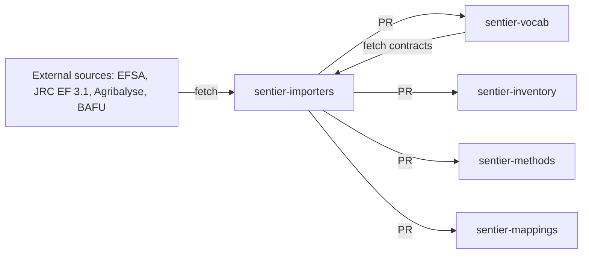
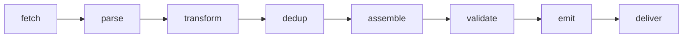

# sentier-importers



## What it is

A plugin framework that imports external data into the Sentier data repos. Each data source is a plugin. The framework runs every plugin through one staged pipeline:



- The framework owns the driver and the shared services: cached fetch, parsers, dedup, validation against the sentier-vocab contracts, YAML/JSON/Parquet writers, PR delivery.
- A source declares itself in `app/sentier_importers/registry.yaml` and implements `transform` in `app/sentier_importers/sources/<name>/source.py`.

## Install

Needs Python 3.10 or newer and `uv`.

```bash
uv sync --extra dev
```

## Use

List registered sources, their targets, and whether they are enabled:

```bash
uv run sentier-importers list
```

Run one source as a dry run. Files land in `output/<target>/<category>/`, no PR is opened:

```bash
uv run sentier-importers run <source>
```

`validate <source>` runs the same pipeline up to the validate step and emits nothing.

sentier-vocab is delivered one source release at a time. Run every source of a release and stage its two layers, `output/sentier_vocab/terms/<release>[-NN].parquet` and `output/sentier_vocab/relations/<release>.parquet`:

```bash
uv run sentier-importers run --release <release>
```

Options for `run`. The last three rows also apply to `validate`:

| Option | Effect |
|---|---|
| `--all` | run every enabled source instead of one; this is the CI smoke test |
| `--release <release>` | run every sentier-vocab source of one source release (their registry `category`, e.g. `bafu-2026`) |
| `--deliver` | also open a PR on the target repo; needs an authenticated `gh` |
| `--deliver-local <path>` | copy the emitted files into a local checkout of the target; no git, no PR |
| `--offline` | fail on any fetch cache miss |
| `--cache-dir`, `--output-dir` | override the fetch cache and the staging dir |
| `--schema-dir` | read the sentier-vocab contracts from a local `schemas/` folder, and the existing terms from the `terms/` folder beside it, instead of the target's pinned ref |

## Layout

```
app/sentier_importers/
  registry.yaml    the source registry, one commented block per source
  core/            pipeline driver, fetch, parse, dedup, vocab contracts and layers, write, deliver, targets
  matching/        BAFU to EF flow matching, used by the bafu and eaternity sources
  sources/         one folder per source, example_csv/ is the reference plugin
scripts/           local BAFU regeneration driver and output checks
tests/             core/ framework tests, sources/ plugin tests
```

## Data

- Inputs: `file://` and `http(s)://` URLs. Fetches are cached in the user cache dir, `~/.cache/sentier_importers/` on Linux, keyed by the SHA-256 of the URL.
- Outputs: Parquet for vocabulary terms and relations and for bulk tables, randonneur JSON for mappings. Never TTL.
- Most sources are `enabled: false`. Big imports are opt-in so `run --all` stays fast.
- The Agribalyse, EF and BAFU sources read local `file://` paths. See "Local inputs" below.
- Vocabulary terms go to sentier-vocab as two layers per source release: `terms/<release>[-NN].parquet` holds every term of the release, all types mixed, and `relations/<release>.parquet` every edge between terms. A source in `registry.yaml` is one part of a release: its `category` is the release and its `term_type` the value of the `type` column. Rows are checked against `schemas/term.yaml` and `schemas/relation.yaml` of sentier-vocab, read at `main`. A delivery (`--deliver` or `--deliver-local`) replaces the files of its release whole and touches no other release; `python -m sentier_vocab validate` in the target repo then checks the whole tree. A single vocab source is staged under `output/sentier_vocab/parts/<source>/` and is never delivered on its own.
- The terms Sentier.dev curates itself (units QUDT lacks, unit groups, flow properties, sources, contacts) are authored in `app/sentier_importers/sources/sentier_core/data/seed.yaml` and delivered as the release `sentier-core`. Edit the seed, then `run --release sentier-core`.
- Inventory tables go to one folder per source release, `data/<source>-<source_version>/` (the registry `category`, e.g. `bafu-2026-v1`), with the sector as a column on `processes.parquet`. A delivery replaces that folder whole; sources never share a folder.

### Local inputs

Every `file://` input in `registry.yaml` is written as `file://${SENTIER_DATA_ROOT}/<repo-or-folder>/...`.
The data root is resolved once per run, first hit wins:

1. `--data-root DIR` on `list`, `validate` and `run`.
2. The `SENTIER_DATA_ROOT` environment variable.
3. The parent directory of this checkout. Clone the sibling repos beside `sentier-importers` and nothing needs setting.

Each source declares who can hold its inputs. `sentier-importers list` prints it as the last column:

| `access`   | meaning |
|------------|---------|
| `public`   | http(s) inputs or a public `sentier-*` checkout beside this repo |
| `licensed` | at least one input you obtain from its provider under their terms, e.g. the BAFU-2026 v1 EcoSpold export at `<root>/sources/bafu-2026/` |
| `private`  | at least one DdS-internal artifact (`dds-agribalyse`, `dds-carbonminds-data`); these sources only run inside DdS |

A missing local input is a warning, not an error: `validate` and `run` print the path, the registry input, the root that was used, and the `access` class, then skip that source (`run --all` carries on with the rest). Any other fetch failure is still an error.

## Contributing

1. Add `app/sentier_importers/sources/<name>/source.py` with a `Source` subclass that implements `transform`. Override `fetch` or `parse` only if the input needs it.
2. Add a block to `registry.yaml`.
3. Add tests under `tests/sources/` with a cached fetch fixture. Tests run offline.

Format and test before committing:

```bash
uv run --extra dev pre-commit run --all-files
```

```bash
uv run --extra testing pytest
```

CI also runs the plugin tests with `uv run --extra testing pytest app/sentier_importers/sources/`.

## Licence

BSD 3-Clause. See `LICENSE`.
