# Inventory import workflow

Implemented lineage layout: current bundles travel with artifacts; historical runs
remain in a separate local archive.

```mermaid
flowchart LR
    subgraph INPUT["INPUT - local source files"]
        A["SENTIER_DATA_ROOT / registry-defined path"]
        B["DIR / registry-defined path"]
        C["Custom source file path"]
    end

    R("uv run sentier-importers run SOURCE<br/>Import pipeline")
    O("Record events during execution in a temporary working log<br/>On success: finalize bundle with RUN-ID and checksums<br/>Store artifact with matching bundle; archive the run")

    subgraph LOCAL["OUTPUT - LOCAL destinations"]
        D["sentier-importers/output/sentier_inventory/SOURCE-FOLDER/<br/>|-- FILE<br/>`-- .lineage/<br/>&nbsp;&nbsp;&nbsp; `-- FILE/<br/>&nbsp;&nbsp;&nbsp;&nbsp;&nbsp;&nbsp; |-- manifest.json<br/>&nbsp;&nbsp;&nbsp;&nbsp;&nbsp;&nbsp; |-- events.jsonl<br/>&nbsp;&nbsp;&nbsp;&nbsp;&nbsp;&nbsp; `-- upstream/ (if available)"]
        E["DIR/sentier_inventory/SOURCE-FOLDER/<br/>|-- FILE<br/>`-- .lineage/<br/>&nbsp;&nbsp;&nbsp; `-- FILE/<br/>&nbsp;&nbsp;&nbsp;&nbsp;&nbsp;&nbsp; |-- manifest.json<br/>&nbsp;&nbsp;&nbsp;&nbsp;&nbsp;&nbsp; |-- events.jsonl<br/>&nbsp;&nbsp;&nbsp;&nbsp;&nbsp;&nbsp; `-- upstream/ (if available)"]
        F["REPO/data/SOURCE-FOLDER/<br/>|-- FILE<br/>`-- .lineage/<br/>&nbsp;&nbsp;&nbsp; `-- FILE/<br/>&nbsp;&nbsp;&nbsp;&nbsp;&nbsp;&nbsp; |-- manifest.json<br/>&nbsp;&nbsp;&nbsp;&nbsp;&nbsp;&nbsp; |-- events.jsonl<br/>&nbsp;&nbsp;&nbsp;&nbsp;&nbsp;&nbsp; `-- upstream/ (if available)"]
        Q["sentier-importers/output/lineage/runs/<br/>`-- RUN-ID/<br/>&nbsp;&nbsp;&nbsp; |-- manifest.json<br/>&nbsp;&nbsp;&nbsp; |-- events.jsonl<br/>&nbsp;&nbsp;&nbsp; `-- upstream/ (if available)<br/>Historical bundles: one directory per successful run"]
    end

    L("Copy artifact and matching bundle<br/>to local checkout")
    G("Copy artifact and matching bundle<br/>to delivery checkout,<br/>commit, push and open PR")

    subgraph REMOTE["OUTPUT - REMOTE Git destinations"]
        H["sentier-inventory/data/SOURCE-FOLDER/<br/>On PR branch<br/>|-- FILE<br/>`-- .lineage/<br/>&nbsp;&nbsp;&nbsp; `-- FILE/<br/>&nbsp;&nbsp;&nbsp;&nbsp;&nbsp;&nbsp; |-- manifest.json<br/>&nbsp;&nbsp;&nbsp;&nbsp;&nbsp;&nbsp; |-- events.jsonl<br/>&nbsp;&nbsp;&nbsp;&nbsp;&nbsp;&nbsp; `-- upstream/ (if available)"]
    end

    I("uv run inspect-lineage --artifact PATH/FILE<br/>inspect_artifact(): read matching bundle<br/>Verify artifact, events and upstream checksums")
    COUT("Clone or check out the PR branch<br/>with artifact and matching bundle")
    VIEW("Open the printed graph link<br/>in a browser; default depth 8")

    subgraph SERVICE["LOCAL SERVICE - Marquez already running"]
        M["Marquez server<br/>API: http://localhost:5000<br/>UI: http://localhost:3000<br/>Stores jobs, datasets and run metadata"]
    end

    A -->|"<b>default</b>"| R
    B -->|"--data-root DIR"| R
    C -->|"--input-file FILE"| R
    R --> O
    O -->|"<b>default</b>"| D
    O -->|"--output-dir DIR"| E
    O -->|"archive under new RUN-ID"| Q
    D -->|"--deliver-local REPO"| L
    E -->|"--deliver-local REPO"| L
    L --> F
    D -->|"--deliver"| G
    E -->|"--deliver"| G
    G --> H

    D -->|"inspect staged artifact and bundle"| I
    E -->|"inspect staged artifact and bundle"| I
    F -->|"inspect checkout artifact and bundle"| I
    H --> COUT
    COUT --> F
    I -->|"POST each event from events.jsonl and upstream bundles<br/>to /api/v1/lineage; GET graph to verify"| M
    I -->|"after graph verification: print UI link"| VIEW
    VIEW -->|"open dataset lineage in Marquez UI"| M

    classDef localFile fill:#DBEAFE,stroke:#1D4ED8,color:#172554,stroke-width:2px;
    classDef remoteFile fill:#F3E8FF,stroke:#7E22CE,color:#3B0764,stroke-width:2px;
    classDef command fill:#F3F4F6,stroke:#4B5563,color:#111827,stroke-width:2px,stroke-dasharray:5 3;
    classDef service fill:#D1FAE5,stroke:#047857,color:#064E3B,stroke-width:2px;
    class A,B,C,D,E,F,Q localFile;
    class H remoteFile;
    class R,O,L,G,I,COUT,VIEW command;
    class M service;
    style INPUT fill:#EFF6FF,stroke:#1D4ED8,color:#172554
    style LOCAL fill:#EFF6FF,stroke:#1D4ED8,color:#172554
    style REMOTE fill:#FAF5FF,stroke:#7E22CE,color:#3B0764
    style SERVICE fill:#ECFDF5,stroke:#047857,color:#064E3B
```



**Legend:** blue rectangles are local files/directories; purple rectangles are
remote Git files/directories. Gray rounded boxes with dashed borders are
commands/operations. Green identifies the running local Marquez service, separate
from the three file-storage groups.

- Each artifact destination contains only its matching lineage bundle. No pointer
  is needed in this layout. Replacing the artifact also replaces this
  bundle; historical bundles remain separately in `lineage/runs/RUN-ID/`.
- Logging happens during the import. The intermediate operation summarizes the
  working log and successful finalization; it is not an additional storage level.
  Failed runs do not produce successful artifact bundles.
- The run archive node shows its default location. With `--output-dir DIR`, it
  moves to `DIR/lineage/runs/` along with the staging base. Lineage-specific path
  overrides are not shown yet.
- Delivery copies the artifact and its current bundle together. The local staged
  output remains. A remote PR branch does not imply a merged release.
- Staging uses `sentier_inventory` (underscore); the repository is named
  `sentier-inventory` (hyphen).
- For `bafu-processes`, `SOURCE` is `bafu-processes`, `SOURCE-FOLDER` is
  `bafu-2026-v1`, and `FILE` is `processes.parquet`. `RUN-ID` is unique per run.
- Commands run from `sentier-importers/`. `SENTIER_DATA_ROOT` defaults to its
  parent directory when unset. Input selection is independent of output selection.
- Inspection is a separate command; the import does not upload to Marquez.
  `PATH/FILE` selects the actual local artifact, and its matching bundle is read
  automatically. Inspection uses the current bundle, not the historical archive
  or temporary log. Bundle lookup reads the adjacent current bundle;
  the command syntax and Marquez submission behavior are shared across all targets.
- `inspect_artifact()` submits each event from the matching `events.jsonl` and
  available upstream bundles, upstream first. It uses manifests for local
  verification; it does not upload the source ZIP, artifact, manifest file or
  entire bundle as files. Marquez receives metadata, including recorded previews.
- For remote Git data, first clone/check out the relevant branch locally. The
  standard inspection command reads local files, not GitHub URLs. The server is
  assumed to be running already; inspection does not start it.

Default staging example (run from `sentier-importers/`):

```powershell
uv run inspect-lineage --artifact output/sentier_inventory/bafu-2026-v1/processes.parquet
```
